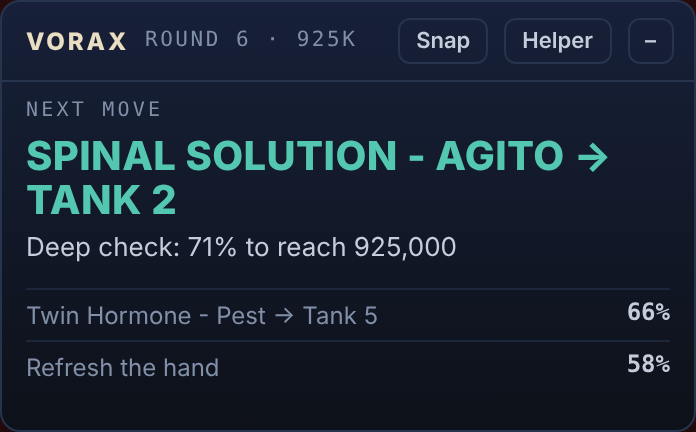

# Vorax Helper

A helper for **Torchlight: Infinite's Vorax / Surgical Preparation** minigame. It reads your board from the game
window, tells you the best move, and shows it in a small card over the game, with the card, tanks and Confirm
boxed on screen.

It only reads and advises. **It never clicks or types in the game:** you play every move yourself.

## Download and run (Windows)

1. Go to **[Releases](../../releases/latest)** and download `Vorax-Helper-Setup.exe`.
2. Run it. It installs for your Windows user only and starts by itself. Windows SmartScreen may say "Windows
   protected your PC" because the installer isn't signed: click **More info → Run anyway**.
3. In the game, turn the log on once: **Esc → Account Related → Enable Log**, then log out and back in.
4. Play **windowed or borderless**: nothing can draw over exclusive fullscreen.
5. Open Surgical Preparation. The helper finds the game window and its log by itself, and the card over the game
   updates after every move.

Don't run the game or the helper as administrator: Windows then refuses the helper's picture of the game window.

### Hotkeys
| Keys | What it does |
|---|---|
| Ctrl+Alt+V | show or hide the card over the game |
| Ctrl+Alt+H | open the helper |
| Ctrl+Alt+X | read the board now |
| Ctrl+Alt+J | something went wrong: save a debug bundle, and send it if you want |

The tray icon (by the clock) has the settings: the advice to show, your target score, game speed, the highlight,
and from which round you play on your own (round 11, the protocols, by default).

## The overlay
The overlay is the Windows app's card that sits over the game while you play, so you never have to switch windows.

*(an example card)*

- **Next move** in large letters: the card to take and the tank(s) to use it on, or to refresh, or which instrument
  or protocol to pick.
- Under it, **how good it is**: the chance of reaching your target score once the deep check has run, or the
  look-ahead's expected result before that. Below, the **next-best options** with theirs, so you can see when two
  moves are close.
- The top bar shows the **round and your target**. A thin moving line under it means the advice is still being worked
  out; it updates by itself when it's done.
- **Warnings** in amber when the reader wasn't sure of something on the board ("check tank 3"): fix it in the
  helper (Ctrl+Alt+H) and the advice follows.
- **Buttons**: Snap reads the board again now, Helper opens the full board analyzer, – folds the card to its top bar.
  Drag the card by its top bar to put it anywhere; it remembers where.
- From **round 11** (the protocols) the highlight hides and you finish the run yourself; change it in Settings →
  Overlay & highlight, where you can also hide the card while the game isn't in front.
- The card and highlight show up in OBS and screenshots (handy for streams), but the helper never reads them
  itself: it only looks at the game window.

### The highlight
Besides the card, the helper draws the advised move right onto the game screen, so you can play it without reading:
- **Numbered, glowing boxes** over each spot of the move, in the order you click them: **1** the card to play,
  **2** the tank(s) to use it on, **3** Confirm. For a refresh it boxes the Refresh button; for an instrument or a
  protocol pick, the card to take, then Confirm.
- Boxes labelled **"working it out…"** show the instant answer while the look-ahead is still running; they switch to
  the final move by themselves when it's done.
- The boxes are **only drawn**: your clicks go straight through them to the game, and the helper never reads them.
- From **round 11** (the protocols) the boxes hide and you finish the run yourself.
- Turn it off, or change the round, in Settings → Overlay & highlight (or the tray icon → Highlight the move).

The overlay updates after every move, from the game's log and from watching the game window. It never clicks or types
in the game.

## What the advice is
Every option is played out to the end of the run in simulation, from your exact board, and ranked by the score it
leads to and by the chance of reaching your target (925k by default). The strategy guide in the helper
(`web/strategy.html`) explains the instrument builds and refreshes, with the simulation evidence behind them.

## Privacy
- Pictures of the game window and the game log stay on your PC.
- **Board sharing is on by default**: the boards the helper reads (tank numbers, card and instrument names, the
  round) are sent to the helper's maker to improve its advice. No pictures, names, accounts or anything about you.
  You're told the first time, and can turn it off in the helper (Share boards).
- Problem reports are sent only when you press Send (Report a problem, or Ctrl+Alt+J in a game).

## Reporting a problem
Something read wrong or the advice looks off? Press **⚑ Report a problem** at the top of the board analyzer, say
what went wrong in a line, and press Send: the helper's record of the run (its pictures of the game window, what it
read and advised, your fixes) goes to the developer in one click. During a game, **Ctrl+Alt+J** marks the moment and
asks on the card whether to send it. Each report also opens an [issue](../../issues) here with your note and the
board at the time (never the pictures), where you can follow it.

## Without installing
Open `web/index.html` in Chrome or Edge: the board analyzer works in the browser too (enter the board, drop a
screenshot, or follow a live game by sharing the game window and the log file).

## Building it yourself
- Web bundles: `bun scripts/build-web.mjs` (writes `web/js/vorax-engine.js` and `web/js/vorax-workers.js`).
- Desktop app: in `desktop/`, `npm install`, then `npm start` to run it or `npm run dist` for the installer
  (`desktop/dist/Vorax-Helper-Setup.exe`). Or double-click `Start-Vorax-Helper.bat` (needs Node.js).
- `worker/`: the Cloudflare Worker that collects shared boards (see `worker/SETUP.md`).
- `DEBUGGING.md`: how the reader records what it saw, and how to replay a debug bundle.

## Credits
- **Moebing**, [Torchlight-Infinite-SS11-Vorax-simulator](https://github.com/Moebing/Torchlight-Infinite-SS11-Vorax-simulator): the original Vorax simulator, used to gather the
  data the advice is built on (MIT, see LICENSE).
- **Arcasti**, [tli-warden](https://github.com/arcasti/tli-warden): her solver logic.
- **Sif**, [tli-tools](https://github.com/WolfDan/tli-tools): help with the in-game textures.

Vibe coded by Timer.
